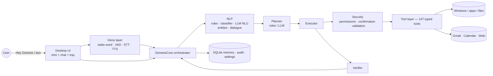

# GENESIS — Intelligent Desktop AI Assistant

> *“I have an AI assistant living on my computer that I can talk to and ask to perform tasks.”*

Genesis is a **Windows desktop AI assistant**. It lives in the system tray, wakes up when you say **“Hey Genesis”** (or press **Ctrl+Alt+G**), understands what you ask using an NLP pipeline, plans the work, checks permissions, **actually carries out the task** through a controlled tool layer, checks that it worked, and tells you the result in text and speech.

**New in 2.2:** Genesis knows which window you're in and codes there — write, edit, fix and run code in online
compilers and coding sites; Google Colab now opens in **your own Google account in Chrome** and Genesis writes, runs,
edits and fixes cells; voice transcription is sharper and context-aware ("what did you hear?" shows what it understood).

**New in 2.1:** image search and generation that keep working without Hugging Face credits, much more accurate voice
(Gemini transcription; "image of a dragon" is no longer heard as "email"), a ChatGPT-style **voice chat** mode
("let's chat"), **Google Meet** ("start a new meeting", "join abc-defg-hij") and **minutes of meeting** ("take meeting
notes" … "stop meeting notes" → a Word document with decisions and action items). Run `Update_Genesis.bat` once after
updating.

**New in 2.0:** safer and more reliable, without rewriting 1.x (everything new is in `genesis/v2/`, existing code only got
small marked hooks). Approvals are bound to the exact action, duplicate sends are caught, risky steps are never retried
blindly, long model-made plans are shown in full before the first step runs, unfinished tasks are saved and can be resumed
(“continue where you stopped”, “what tasks are unfinished?”), a running task can be cancelled from the tray, commands quoted
from someone else's message are ignored, and parsing is ~50× faster. Measured results: `docs/GENESIS_EVALUATION.md`;
audit: `docs/GENESIS_ARCHITECTURE_AUDIT.md`. Switch the new understanding layer off with `GENESIS_V2_NLU=0`.

**New in 1.3:** Genesis understands goals, not just commands. It works out the steps for things it was never programmed for,
takes corrections (“no, I meant AI internships”), undoes things, recognises **your name** however the recogniser spells it, learns
your preferences (“I prefer Gmail”), can see and click web pages and windows by name, and can change your projects (showing the diff first).

**New in 1.2:** Genesis works as an agent, not just a command runner. It can **play YouTube videos and control playback, manage your
windows, create/move/cancel calendar events, write and run programs (and fix its own errors), handle multi-step Gmail tasks**, answer questions from
the web, and remember your preferences and past conversations. See [CHANGELOG.md](CHANGELOG.md).

**New in 1.1:** say the wake word once and **keep talking**. Genesis understands follow-ups like “open the second one”, “change tomorrow to Friday” and “send it”, and goes back to sleep by itself when you stop talking. See [CHANGELOG.md](CHANGELOG.md). To upgrade an existing install in place, see [UPGRADE.md](UPGRADE.md).

```
VOICE / TEXT → UNDERSTANDING → PLANNING → PERMISSION → REAL TOOL EXECUTION → VERIFICATION → RESPONSE (+ TTS)
```

**NLP topic (CO1):** Conversational AI / Chatbot Systems. The full academic report is in [`docs/academic/CO1_NLP_Report.md`](docs/academic/CO1_NLP_Report.md).

---

## What it does

| You say | Genesis does |
|---|---|
| “Hey Genesis, open Chrome” | launches Chrome |
| “Open Gmail” | opens Gmail in your browser |
| “Open my Downloads folder” | opens it in File Explorer |
| “Search the web for the latest NVIDIA announcement” | runs the search in your browser (and summarises the top results if the optional search package is installed) |
| “Draft an email to my professor saying I will submit the NLP assignment tomorrow” | looks up “my professor” in your contacts, writes the e-mail, **creates a real Gmail draft** through the Gmail API and opens it for review. It sends only if you say “send it” **and** confirm |
| “Draft an email to Rahul.” → “What should I say?” → “Tell him I'll reach at 5.” | multi-turn dialogue with coreference (“him” = Rahul) |
| “Remind me tomorrow at 9 AM to submit my assignment” | creates a persistent reminder that pops up and is spoken at 9:00 |
| “Open VS Code and open my Genesis project” | launches VS Code on the project folder |
| “Find the error in app/main.py” | static check (never runs your code) + LLM explanation |
| “Hey Genesis” → “check my unread emails” → “open the latest one” → “reply saying I'll submit it tomorrow” → “actually change tomorrow to Friday” → “send it” | one continuous conversation, with the wake word said once: reads, threads the reply, edits the same draft, and sends only after you confirm |
| “Every Monday at 8 AM, open VS Code and my Genesis project” | saves a routine (after asking) that runs through the same permission checks |
| “Check my calc project for errors” → “fix the first one” | diagnoses, proposes a minimal fix, **asks**, backs up, applies, runs your tests, and can “undo that” |
| “What's on my screen?” | captures once, only on request, and reports structured text and controls (optional packages) |
| “Open YouTube” → “search for Python tutorials” → “play the second one” → “pause” → “make it louder” | searches YouTube, plays the right video, controls playback |
| “Put a meeting with Rahul tomorrow at 4” / “move my 3 PM meeting to 5” / “what do I have tomorrow?” | Google Calendar create / move / read (asks for the time if you don't say it) |
| “Create a Python script that reads this CSV and finds the top 10 users” | writes the code, creates the project, opens VS Code, runs it, fixes errors, shows the output |
| “Find the latest email from AMD, summarize it and draft a reply saying I'm interested” | search → open → summary → threaded reply draft (sends only after “send it” + yes) |
| “Switch to Chrome”, “minimize it”, “take a screenshot” | window management and screenshots |
| “Find that Python tutorial we were talking about yesterday” | searches past conversations and tasks, then “open the first one” |
| “My name is Srikanth Mandyam Manadhare” → (later, by voice) “this is Shri Kant” | recognises you despite the spelling; asks once when unsure and learns |
| “Search for internships” → “No, I meant AI internships” | modifies the task instead of starting over |
| “Prepare my computer for coding” / “Find five AI internships I can apply for” | plans a goal it has no template for; re-plans once if a step fails |
| “Remember that I prefer Gmail” → “Open my email” → “Why did you open Gmail?” | uses and explains stored preferences |
| “Find the internship application button” → “click it” | finds page/window elements by name (never coordinates); asks before clicking |
| “Add dark mode to my site project” → “undo that” | multi-file change with a diff shown first, backups, tests, and undo |
| “Shut down my computer” | asks *“This will shut down your computer. Do you want me to continue?”* and only acts on an explicit **yes** |
| “Message Rahul saying I'll call him in ten minutes” → *“I've drafted the message to Rahul … Send it?”* → “yes” | WhatsApp (Web in Edge, or the Windows app): drafts, **asks**, sends, then checks it shows as sent |
| “Show me the latest WhatsApp message from Mom” → “reply to that saying I'll be there at 7” | reads the chat and replies to the right person |
| “Open Colab” → “create a notebook” → “write code that loads data.csv” → “run it” → “why did it fail?” → “fix it and run it again” | operates Google Colab: types code, runs the cell, reads output and errors, fixes and re-runs (risky code asks first) |
| “Show me a picture of a peacock” / “Generate a futuristic image of a city” | finds a freely licensed picture (or generates one) and **shows it in the chat** |
| “Fill this form using my resume” → “don't submit it yet” → “change my phone number to …” → “okay, submit it” | fills fields from your résumé, never guesses or fills passwords/ID numbers, and submits only after you confirm |
| “Click the second button”, “type hello in the search box”, “press ctrl+s”, “scroll down”, “copy”, “paste” | operates *any* app through the accessibility tree (names, not coordinates); send/pay/delete clicks ask first |
| “Rename the selected layer in this app to Background” (an app Genesis has no tool for) | an observe → act → verify loop over the generic computer tools |
| “Make a PowerPoint on solar energy with 5 slides” / “create an Excel sheet for my monthly budget” / “write a paragraph about India in Word” | writes the content, builds the file and opens it in Office — or adds it to the document you have open (never saves over your work) |
| “Open my GitHub repositories” / “create a private repo called demo-app” / “delete my GitHub repo demo” | GitHub via your token; deleting asks you to type the name **and** confirm, then checks it's gone |
| “Chrome won't open” / a site doesn't load | works out *why* (not installed, missing executable, blocked, offline, DNS, site down, timeout) and says it plainly |
| “Find the latest assignment PDF, rename it, open Gmail, attach it, and draft an email to my professor” | a multi-step plan with follow-up questions, a confirmation for the rename, and a draft with the attachment |

## Features

- **Conversation mode (1.1).** Wake once and follow-ups need no wake word. It sleeps automatically after a configurable silence; the timer starts only after the reply finishes. You can interrupt it (barge-in), say “go to sleep”, and an explicit state machine (SLEEPING → WAKING → ACTIVE_CONVERSATION → THINKING → EXECUTING → VERIFYING → WAITING_FOR_USER → RETURNING_TO_SLEEP) is shown on the orb.
- **Context-aware follow-ups (1.1).** “open it”, “close that”, “the other one”, “do that for Rahul too”, “try again”, “go back”, “the one we discussed earlier”, “make it shorter”. When a reference is ambiguous it asks instead of guessing.
- **Routines, usage learning, screen understanding and a coding-agent loop (1.1).** See [CHANGELOG.md](CHANGELOG.md).
- **Two UI states.** A compact floating **mini assistant** with an animated orb (idle, listening, thinking, executing, speaking, waiting for confirmation, error, success) and an expanded **desktop chat window** with conversations, live plan/tool cards, confirmation cards, and Memory, Tools & permissions, Activity (audit log), Connected services, and Settings pages.
- **System tray.** Open, start/stop listening, pause, settings, memory, services, activity, and quit. Optional *start with Windows*. Global hotkey. Single running instance.
- **Voice.** Local wake word (“Hey Genesis”) with Vosk constrained-grammar keyword spotting or Picovoice Porcupine. Energy-based voice activity detection. Local speech-to-text with faster-whisper (Vosk as fallback). Windows SAPI text-to-speech that you can interrupt (barge-in). Visible microphone privacy indicator; the mic is physically closed when listening is off.
- **NLP pipeline.** Wake-phrase normalisation, splitting of compound requests, high-precision rules, a **TF-IDF + logistic-regression intent classifier**, an optional **LLM structured-NLU** fallback, entity extraction (people, e-mails, URLs, paths, apps, folders, dates and times), and a **dialogue manager** with slot filling and coreference.
- **LLM abstraction.** Hugging Face Inference Providers (default **Qwen/Qwen2.5-72B-Instruct**), any OpenAI-compatible endpoint, **Ollama** (fully local), or an offline ELIZA-style fallback. Degrades gracefully with no network.
- **Agent.** Rule-based and LLM planner, then an executor that resolves templates, validates the schema, checks permissions, confirms, runs the tool, verifies the result and writes an audit record, then a verifier that builds the reply only from actual tool results. Safe automatic recovery (for example, a Gmail compose window when OAuth has expired).
- **147 typed tools.** Apps, files, web, browser automation (Playwright), system/power, Gmail, Calendar, reminders, VS Code, memory, knowledge base, and settings. **There is no “run any shell command” tool.**
- **Gmail.** OAuth 2.0 loopback flow with PKCE. Tokens are kept in Windows Credential Manager or a DPAPI-encrypted vault. Create a draft, send only after confirmation, and search/read mail (treated as untrusted content).
- **Memory.** Short-term dialogue state, session tasks, persisted conversations, and explicit long-term facts, contacts and projects. You can view, delete or disable all of it.
- **Knowledge base (RAG).** Ingest txt, md, pdf, docx and code files, chunk them, embed them (all-MiniLM-L6-v2, or a local hashing fallback), retrieve by cosine similarity, and answer with citations.
- **Security.** Risk levels, a permission manager, a confirmation manager, path/URL/filename/e-mail validation, write-protection for system folders, a block on credential stores, prompt-injection defences, secret redaction in every log, and an audit trail.
- **Agent capabilities (1.2).** YouTube, media keys, window management, screenshots, Google Calendar (CRUD), coding agent (Python, JavaScript, TypeScript, Java, HTML) with a run → read error → fix → re-run loop, Gmail agent tasks, web answers, preferences and conversation history search, typo/slang tolerance.
- **Intelligence (1.3).** Context engine, goal planning for requests it has never seen (with one re-plan on failure), corrections (“no, I meant…”), multi-step undo, identity and name recognition that learns how the speech recogniser spells your name, typed preferences and standing instructions, a universal browser/screen element layer, project-level code changes with diffs, safe developer commands, to-do list and notes, and caching.
- **Desktop agent (1.4).** A generic computer-control layer (observe, click, double/right-click, type, press, hotkeys, copy, paste, select, scroll, drag) that prefers the accessibility tree, then element positions, and uses coordinates only as a confirmed last resort; an observe → act → verify loop for unfamiliar apps; WhatsApp (Web or desktop app) with drafting, confirmation and sent-verification; Google Colab (notebooks, cells, run, read errors, fix, re-run); picture search and generation shown in the chat; form filling from your résumé; self-diagnosis for apps, websites and the AI model; a warmer persona (“Done, Boss.”, configurable) and a natural female voice (Windows voices, or the optional offline neural Piper voice).
- **Any language (1.6).** Speak or type in Hindi, Kannada, Tamil, Telugu, French, Spanish, German, Japanese, Chinese, Arabic and more. Genesis detects the language offline (Unicode scripts + function-word profiles, plus Whisper's own language ID for voice), translates the request to English with the LLM, runs the normal pipeline, and replies — and speaks, with a matching Windows voice — in your language. English costs no extra model call; “oui/nahi/はい” confirmations are understood offline; message bodies are never translated.
- **Tests.** 524 automated tests covering unit, integration, tools, security, database, NLP, agent, voice pipeline, conversation sessions, follow-ups and end-to-end scenarios.

## Quick start (Windows 10/11 + VS Code)

1. Install **Python 3.12** from [python.org](https://www.python.org/downloads/) and tick “Add python.exe to PATH”. Install **VS Code**.
2. Unzip Genesis, then in VS Code use **File → Open Folder…** and choose the `genesis` folder. Install the recommended extensions when prompted.
3. Run the first-time setup. Either double-click **`setup.bat`**, or in VS Code use **Terminal → Run Task… → “Genesis: First-time setup”**.
   This creates `.venv`, installs dependencies, creates `.env`, downloads the offline voice model (~40 MB), runs `--doctor`, and runs the tests.
4. *(Recommended)* Open `.env` and set `HF_TOKEN=` to your Hugging Face token (see [docs/SETUP.md](docs/SETUP.md#hugging-face-token)). Check it with `.\.venv\Scripts\python.exe -m genesis --check-llm`, and pick the fastest model for your connection with `--benchmark-llm`.
   Without it Genesis still works, but in offline mode: all local actions work, and open-ended chat is limited.
5. *(For Gmail drafts)* Add `GOOGLE_CLIENT_ID` and `GOOGLE_CLIENT_SECRET` ([step-by-step guide](docs/SETUP.md#gmail-google-oauth)), then go to **Genesis → Connected services → Connect Google account**.
6. Press **F5** in VS Code and pick **“Genesis: Desktop app”**. You can also double-click `run_genesis.bat`, or run:
   ```powershell
   .\.venv\Scripts\python.exe -m genesis
   ```
7. Say **“Hey Genesis”**, press **Ctrl+Alt+G**, or click the tray orb.

> **Demo tip:** choose the launch configuration **“Genesis: Desktop app (dry-run power actions)”** so that shutdown, restart, sleep and lock are simulated during presentations.

### Other ways to run

```powershell
python -m genesis --cli          # text chat in the terminal (same brain, no GUI)
python -m genesis --cli --voice  # terminal + "Hey Genesis"
python -m genesis --doctor       # check dependencies, models, keys, microphone
python -m genesis --minimized    # start silently in the tray
python -m pytest -q              # run the test suite
```

## Architecture at a glance



More detail, with nine Mermaid diagrams, is in [docs/architecture/ARCHITECTURE.md](docs/architecture/ARCHITECTURE.md).

## Project structure

```
genesis/
├── genesis/                 # application package
│   ├── core/                # config, paths, logging, events, settings, container, orchestrator, startup
│   ├── nlp/                 # rules, classifier (+data/intents.json), entities, pipeline, dialogue
│   ├── ai/                  # prompts + LLM providers (HF, OpenAI-compatible, Ollama, offline)
│   ├── agent/               # plan, planner, executor, verifier
│   ├── tools/               # 147 tools: apps, files, web/browser, youtube, desktop/windows, system, email, calendar, reminders,
│   │                        #   productivity (to-do, notes), code, code changes & commands,
│   │                        #   coding agent, memory, history, knowledge, settings, routines, screen
│   ├── services/            # platform backend, app resolver, Google OAuth, Gmail, Calendar, scheduler, web, browser
│   ├── memory/              # memory manager, embeddings, knowledge base (RAG)
│   ├── security/            # permissions, confirmation, validators, injection, secrets, redaction
│   ├── voice/               # audio, VAD, wake word, STT, TTS, voice state machine
│   ├── database/            # SQLite + migrations + repositories
│   ├── ui/                  # PySide6 desktop UI (mini window, main window, pages, tray, orb, hotkey)
│   ├── cli.py · doctor.py · __main__.py
├── tests/                   # 524 tests (unittest-compatible, run with pytest)
├── docs/                    # setup, architecture, NLP, API, tools, security, troubleshooting, academic/
├── scripts/                 # setup, model download, build, icon, tool-doc generator
├── installer/genesis.iss    # Inno Setup installer script
├── .vscode/                 # launch/debug configs, tasks, settings
├── data/ · logs/            # runtime data (created automatically)
├── .env.example · requirements*.txt · pyproject.toml · LICENSE
```

## Documentation

| Topic | File |
|---|---|
| Installation & credentials (HF token, Google OAuth, Vosk, Ollama) | [docs/SETUP.md](docs/SETUP.md) |
| Architecture & diagrams | [docs/architecture/ARCHITECTURE.md](docs/architecture/ARCHITECTURE.md) |
| NLP pipeline | [docs/nlp/NLP_PIPELINE.md](docs/nlp/NLP_PIPELINE.md) |
| Core / tool / event API | [docs/api/API.md](docs/api/API.md) |
| Tool reference (generated) | [docs/TOOLS.md](docs/TOOLS.md) |
| Security & privacy | [docs/SECURITY.md](docs/SECURITY.md) |
| Development, testing, building the .exe | [docs/DEVELOPMENT.md](docs/DEVELOPMENT.md) |
| Troubleshooting | [docs/TROUBLESHOOTING.md](docs/TROUBLESHOOTING.md) |
| CO1 NLP report | [docs/academic/CO1_NLP_Report.md](docs/academic/CO1_NLP_Report.md) |
| Literature review | [docs/academic/LITERATURE_REVIEW.md](docs/academic/LITERATURE_REVIEW.md) |
| Presentation outline | [docs/academic/PRESENTATION.md](docs/academic/PRESENTATION.md) |
| Demo script | [docs/academic/DEMO_SCRIPT.md](docs/academic/DEMO_SCRIPT.md) |

## Honest limitations

- **Windows first.** macOS and Linux backends exist for OS actions, but only Windows is the supported desktop target.
- **Wake-word accuracy.** The default Vosk keyword spotter is free and fully local, but it is less robust than a custom-trained Porcupine model. Adjust the sensitivity in Settings, or use Porcupine with a custom “Hey Genesis” `.ppn` file.
- **Gmail needs a Google Cloud OAuth client** (free). Until one is configured, Genesis opens a *pre-filled Gmail compose window* instead of creating the draft through the API, and says so clearly.
- **Open-ended chat, code explanation, and LLM planning need an LLM** (a Hugging Face token, an OpenAI-compatible endpoint, or local Ollama). Everything else runs offline.
- **Browser clicking, WhatsApp Web, Colab and form filling** use Playwright (now in requirements.txt) driving Microsoft Edge. You sign in to WhatsApp (QR code) and Google yourself, once, in that window — Genesis never bypasses sign-ins or CAPTCHAs.
- **Computer control** works on Windows. Apps that don't expose accessibility names (some games, custom-drawn UIs) can only be operated by keys, or by coordinate clicks that you confirm each time. Genesis never types into terminals, the Run box, Start search or File Explorer's address bar.
- **WhatsApp** layouts change; if Genesis can't confirm the right chat is open, or that a message was sent, it stops and says so instead of claiming success.
- **Image generation** needs HF_TOKEN (or an OpenAI key); picture search works without keys (Wikimedia Commons / Openverse).
- **Barge-in with speakers.** Talking over Genesis is detected by loudness. With loudspeakers, its own voice can occasionally trigger it, or quiet speech can be missed, so a headset works best. Interrupting with “Hey Genesis” always works.
- **Screen understanding** needs the optional Pillow, pytesseract (+ Tesseract) and uiautomation packages. Describing images needs a vision model via HF_TOKEN. Clicking works only on *named* controls (“click Save”), not on colours or positions.
- **YouTube** results are read from YouTube's public results page (no API key). If YouTube changes that page, Genesis still opens the results and says it couldn't pick a video. Pause/resume/skip use the system media keys, which control whichever app is playing.
- **Coding agent** needs an LLM (HF token or Ollama). JavaScript/TypeScript need Node.js (TypeScript: Node 22.6+ or `tsx`), and Java needs a JDK 11+. Servers are started and then stopped after a few seconds. Genesis never installs packages for you.
- **Calendar** needs your Google account connected with the Calendar permission, and the Google Calendar API enabled in your Google Cloud project.
- **“Make it shorter/more formal” and code fixes** need an LLM. Word replacements (“change tomorrow to Friday”), additions and subject changes work offline.

## License

MIT. See [LICENSE](LICENSE).
