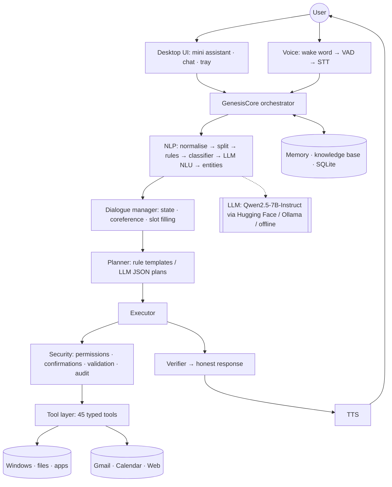
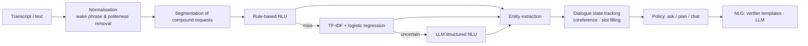
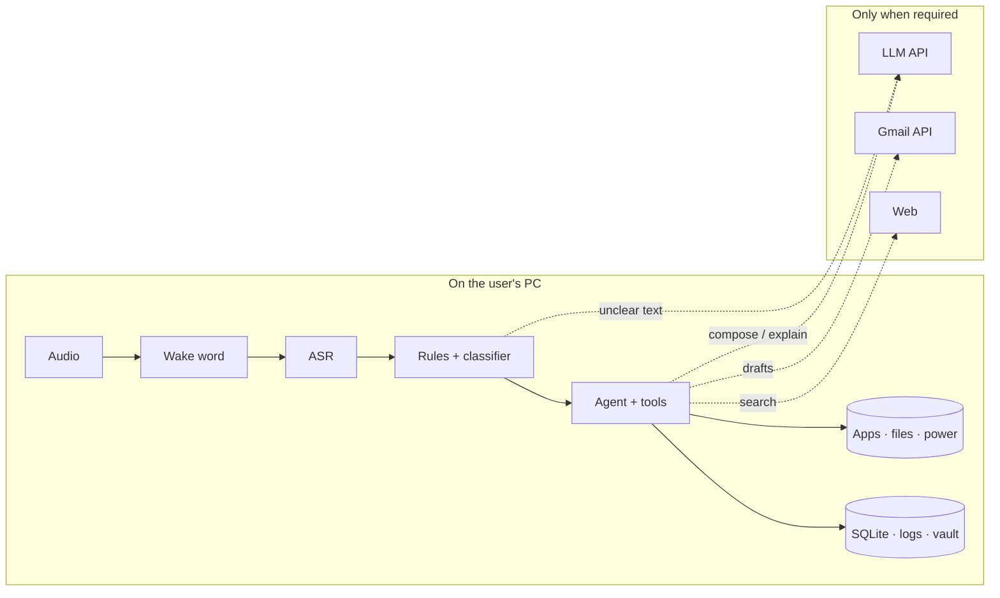
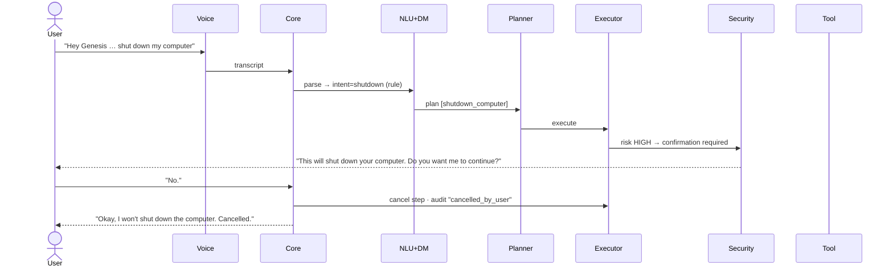

# GENESIS: An Intelligent Desktop AI Assistant
## A Study of Conversational AI / Chatbot Systems and Their Real-World Application

**Course Outcome:** CO1 — *Topic exploration and concept understanding: identify an NLP topic from the syllabus and perform an in-depth conceptual and literature review to understand the corresponding real-world application, underlying architecture and workflow.*

---

### 1. Title

**GENESIS — Intelligent Desktop AI Assistant: Conversational AI and Task-Oriented Dialogue for Desktop Automation**

### 2. Team information

| Role | Name | Register No. | Contribution |
|---|---|---|---|
| Team lead | _<name>_ | _<reg. no>_ | _<architecture, agent layer>_ |
| Member | _<name>_ | _<reg. no>_ | _<NLP pipeline, evaluation>_ |
| Member | _<name>_ | _<reg. no>_ | _<voice pipeline, UI>_ |
| Member | _<name>_ | _<reg. no>_ | _<security, testing, documentation>_ |

**Course:** _<Natural Language Processing — course code>_  **Faculty:** _<name>_  **Institution:** _<name>_  **Semester / Year:** _<…>_

### 3. Selected NLP topic

**Conversational AI / Chatbot Systems.** These are systems that interact with people in natural language over multiple turns, understand what the user means, keep track of the conversation, and respond or act appropriately.

The real-world application studied and built is **Genesis**, a voice- and text-driven desktop assistant for Windows. It is a *task-oriented dialogue system* extended with modern large-language-model (LLM) components: tool calling, planning and retrieval.

### 4. Introduction to Natural Language Processing

Natural Language Processing (NLP) is the branch of artificial intelligence concerned with enabling computers to process, understand and generate human language (Jurafsky & Martin, 2025). It combines linguistics, statistics and machine learning. Its core tasks include:

- **Morphological and lexical analysis:** tokenisation, normalisation, stemming and lemmatisation.
- **Syntactic analysis:** part-of-speech tagging and parsing.
- **Semantic analysis:** word sense, semantic roles, and representing meaning, for example as intents and slots.
- **Pragmatics and discourse:** coreference, dialogue acts, and context.
- **Generation:** producing fluent, appropriate text.
- **Speech:** automatic speech recognition (ASR) and text-to-speech (TTS), which connect spoken language to text.

The field has moved through three broad paradigms:

1. **Symbolic / rule-based** systems (1950s–1980s), such as ELIZA.
2. **Statistical** methods (1990s–2010s): hidden Markov models, conditional random fields, n-gram language models, and TF-IDF with linear classifiers.
3. **Neural** methods (2013–present): word embeddings, recurrent networks, attention, Transformers, and pre-trained large language models.

Genesis deliberately combines all three: rules for safety-critical precision, statistical classification for fast offline intent detection, and neural LLMs for open-ended language.

### 5. Introduction to Conversational AI

Conversational AI refers to technologies that let a user interact with a computer through dialogue. The literature usually distinguishes two families of dialogue system (Chen et al., 2017; Jurafsky & Martin, 2025).

| | Task-oriented dialogue systems | Open-domain chatbots |
|---|---|---|
| Goal | complete a task (book, search, send, open) | engaging, coherent conversation |
| Typical architecture | modular pipeline: NLU → dialogue state tracking → policy → NLG | end-to-end neural response generation |
| Examples | ATIS flight booking, Siri, Alexa skills, Rasa bots | ELIZA, ALICE, Meena, DialoGPT, ChatGPT |
| Evaluation | task success, slot accuracy, turns | human ratings, perplexity, engagement |

Modern assistants such as Genesis are **hybrids**. A task-oriented core decides *what to do* and executes it reliably, and an LLM provides flexible understanding, open-ended conversation and fluent generation.

### 6. Why chatbots are an NLP application

A chatbot is an end-to-end application of nearly every NLP sub-problem:

1. **Understanding** requires tokenisation, normalisation, **intent classification** (text classification) and **named-entity recognition / slot filling** (sequence labelling).
2. **Context** requires **discourse processing**: coreference (“tell *him*”) and ellipsis (“and to Priya too”).
3. **State and decisions** require **dialogue state tracking** and a **dialogue policy** (Young et al., 2013; Williams et al., 2016).
4. **Responding** requires **natural-language generation**, from templates to neural generation.
5. **Voice interaction** adds **ASR**, **keyword spotting** and **TTS**.
6. **Grounded answers** require **information retrieval** and **retrieval-augmented generation** (Lewis et al., 2020).

Because of this, a working assistant is an excellent vehicle for understanding how the syllabus topics fit together in a real product.

### 7. Real-world application: Genesis

Genesis is a lightweight desktop application that lives in the Windows system tray. The user says **“Hey Genesis”** (or presses Ctrl+Alt+G), a compact floating assistant appears, and the user speaks or types a request. Genesis then:

1. transcribes speech locally;
2. understands the intent and entities;
3. asks follow-up questions if information is missing;
4. plans one or more actions;
5. checks permissions and asks for confirmation when an action is risky;
6. **performs the real action** — launching apps, managing files, creating Gmail drafts, setting reminders, opening projects in VS Code, controlling power settings;
7. verifies the result; and
8. replies in text and speech.

It can be expanded into a full chat window with history, live plan cards, memory controls, an audit log and settings.

**Flagship demonstration:**

> **User:** “Hey Genesis.”  → *(orb animates: LISTENING)*
> **User:** “Draft an email to my professor saying I will submit the NLP assignment tomorrow.”
> **Genesis:** *intent = draft_email; recipient = “my professor” → contact “Professor Rao &lt;rao@university.edu&gt;”; message = “I will submit the NLP assignment tomorrow” → composes a formal e-mail → creates a Gmail draft via the Gmail API → verifies it exists → opens it for review* → “Created a Gmail draft to rao@university.edu — subject ‘Submit the NLP assignment tomorrow’. It's open for you to review; say ‘send it’ when you're ready.”

### 8. Problem statement

Existing desktop interaction forces users to translate intentions into long sequences of manual steps: open a browser, navigate to Gmail, compose, look up an address, type, attach, save. General chatbots can *describe* these steps but cannot *perform* them. Commercial voice assistants perform only a narrow, vendor-defined set of actions, often send all audio to the cloud, and give limited transparency about what they did.

**Problem:** design and build a desktop conversational agent that understands natural spoken or typed requests and **safely executes real multi-step desktop tasks**. It must behave honestly (never claim success it did not achieve), protect privacy (local wake word and speech processing), and remain usable without an internet connection.

### 9. Objectives

1. Study conversational AI concepts and their literature, from ELIZA to tool-using LLM agents.
2. Implement a complete NLP pipeline: normalisation, compound-request segmentation, intent classification, entity extraction, dialogue state tracking with coreference and slot filling, and response generation.
3. Integrate speech: local wake-word detection, voice-activity detection, ASR and interruptible TTS.
4. Implement an agent architecture (planner → executor → verifier) over a typed, permission-controlled tool layer.
5. Integrate real services (Gmail through OAuth 2.0, the file system, applications, the browser and VS Code) with graceful degradation.
6. Provide transparent, user-controlled memory and a local knowledge base (RAG).
7. Enforce security: risk levels, confirmations, input validation, prompt-injection defences and audit logs.
8. Evaluate the NLU components and verify the system with automated tests.

### 10. Literature review (summary)

The full review is in [`LITERATURE_REVIEW.md`](LITERATURE_REVIEW.md). Key milestones:

| Era | Work | Contribution relevant to Genesis |
|---|---|---|
| Foundations | Turing (1950) | framing machine conversation as a test of intelligence |
| Rule-based | **ELIZA** (Weizenbaum, 1966); PARRY (Colby et al., 1971); ALICE / AIML (Wallace, 2009) | pattern matching and reflection. Genesis's offline fallback responder is ELIZA-style |
| Task-oriented SLU | ATIS corpus (Hemphill et al., 1990) | intent + slot formulation of spoken language understanding |
| Statistical dialogue | POMDP dialogue systems (Young et al., 2013); Dialog State Tracking Challenges (Williams et al., 2016) | dialogue state tracking and policy as distinct, learnable components |
| Sequence labelling | CRFs (Lafferty et al., 2001); BiLSTM-CRF NER (Lample et al., 2016) | entity extraction as sequence labelling |
| Neural SLU | attention RNN joint intent + slot (Liu & Lane, 2016); **BERT** joint model (Chen et al., 2019) | joint intent classification and slot filling |
| Seq2seq | Sutskever et al. (2014); Bahdanau et al. (2015); neural conversational model (Vinyals & Le, 2015) | end-to-end response generation |
| Transformers | **Attention Is All You Need** (Vaswani et al., 2017); **BERT** (Devlin et al., 2019) | the architecture behind modern NLU and LLMs |
| Large LMs | GPT-2 (Radford et al., 2019); GPT-3 (Brown et al., 2020); InstructGPT (Ouyang et al., 2022); Qwen2.5 (Qwen Team, 2024) | instruction-following generation. Genesis uses Qwen2.5-7B-Instruct |
| Retrieval | **RAG** (Lewis et al., 2020); Sentence-BERT (Reimers & Gurevych, 2019); MiniLM (Wang et al., 2020) | grounding answers in the user's documents with all-MiniLM-L6-v2 |
| Agents | Chain-of-thought (Wei et al., 2022); **ReAct** (Yao et al., 2023); **Toolformer** (Schick et al., 2023); LLM-agent surveys (Wang et al., 2024; Xi et al., 2023) | reasoning plus tool use, the basis of Genesis's planner and tools |
| Speech | HMMs (Rabiner, 1989); DNN acoustic models (Hinton et al., 2012); RNN ASR (Graves et al., 2013); Kaldi (Povey et al., 2011); **Whisper** (Radford et al., 2023) | local ASR (faster-whisper, Vosk/Kaldi) |
| Keyword spotting | small-footprint KWS (Chen et al., 2014) | “Hey Genesis” wake word |
| TTS | WaveNet (van den Oord et al., 2016); Tacotron 2 (Shen et al., 2018) | the neural TTS landscape. Genesis uses Windows SAPI for low latency and offline use |
| Security | indirect prompt injection (Greshake et al., 2023) | untrusted-content isolation and confirmation escalation |

**Foundational NLP vs modern LLM systems.** Foundational research gives Genesis its *structure*: intents, slots, dialogue state, policies and templates. These are interpretable, testable and safe. Modern LLM research gives it *flexibility*: understanding unusual phrasings, writing e-mails and explaining code. Genesis uses LLMs only where their flexibility is needed, and keeps them *below* a deterministic safety layer.

### 11. Existing conversational AI systems

| System | Type | Strengths | Limitations relative to Genesis's goals |
|---|---|---|---|
| ELIZA (1966) | rule-based chatbot | simple, transparent | no understanding, no actions |
| Apple Siri / Amazon Alexa / Google Assistant | commercial voice assistants | robust ASR, ecosystems | cloud-centric audio processing, closed action sets, limited desktop automation (Hoy, 2018) |
| Microsoft Cortana / Copilot in Windows | OS assistants | OS integration | limited user-extensible actions; cloud dependency |
| Rasa (Bocklisch et al., 2017) | open-source task-oriented framework | NLU + dialogue management, on-premise | a framework, not a desktop agent; no built-in OS tools |
| Snips (Coucke et al., 2018) | private-by-design embedded SLU | on-device NLU | discontinued; narrow domains |
| ChatGPT / Claude / Gemini chat apps | LLM chatbots | open-domain fluency, reasoning | web apps; cannot act on the local desktop without extra integration |
| Meena, DialoGPT (Adiwardana et al., 2020; Zhang et al., 2020) | neural open-domain chatbots | human-like chit-chat | no task execution |

**Gap addressed by Genesis:** a *local-first*, *transparent*, *safe* desktop agent that combines task-oriented dialogue with LLM flexibility and actually performs actions.

### 12. Genesis architecture



The implementation is a single Python process: PySide6 (Qt 6) for the native desktop UI, SQLite for storage, and a provider abstraction for LLMs. See [`../architecture/ARCHITECTURE.md`](../architecture/ARCHITECTURE.md) for all nine diagrams.

### 13. NLP pipeline



- **Normalisation.** Removes the wake phrase and its common ASR confusions (“hey jenesis”), and politeness wrappers.
- **Segmentation.** “Open VS Code **and** open my Genesis project” becomes two requests. The split happens only before an action verb, and message bodies (“saying …”) and reminder bodies are protected from splitting.
- **Three-stage understanding.** A cascade from most precise to most flexible (Sections 15–16).

### 14. Speech-to-text pipeline

1. **Capture.** 16 kHz mono 16-bit PCM in 32 ms frames (512 samples) through PortAudio.
2. **Wake word (local).** Every frame goes to a keyword spotter. The default is the Vosk (Kaldi) recogniser with a **constrained grammar** `["hey genesis", "hi genesis", "okay genesis", "genesis", "[unk]"]`. Limiting the decoder's search space to the key phrase turns a general ASR model into a keyword spotter. False activations are reduced with a word-confidence threshold derived from the sensitivity setting, a loudness gate, and a 2-second refractory period. Porcupine, a DNN-based spotter in the tradition of Chen et al. (2014), is supported as an alternative.
3. **End-pointing (VAD).** Frame RMS energy is compared with an adaptive noise floor (an exponential moving average before speech onset). The utterance ends after 0.9 s of silence, with a 6 s no-speech timeout and a 15 s cap.
4. **ASR.** **faster-whisper** (Whisper, Radford et al. 2023, a Transformer encoder–decoder trained on 680k hours of weakly supervised audio) running int8 on the CPU with a biasing prompt that contains assistant vocabulary. Vosk full-vocabulary decoding is the lightweight fallback.
5. **Privacy.** Wake detection and ASR run locally. The microphone stream is physically closed whenever listening is disabled, and the UI and tray show a live indicator.

### 15. Intent understanding

Genesis recognises **22 intents** (`open_application`, `draft_email`, `send_email`, `read_email`, `create_reminder`, `file_operation`, `system_control`, `shutdown`, `restart`, `search_web`, `open_folder`, `open_url`, `browser_action`, `code_action`, `information_request`, `conversation`, `settings`, `memory`, `knowledge`, `ui_control`, `cancel`, `close_application`), plus `unknown`. New intents can be added through the enum, the training data and a planner mapping.

**Stage 1: rules.** Ordered regular-expression patterns handle common and safety-critical commands with near-perfect precision. Power actions (shutdown, restart) are recognised **only** by explicit rules. The statistical and LLM stages can never produce them, which is a deliberate safety design.

**Stage 2: statistical classifier.** Each utterance *d* is represented by TF-IDF features:

  *tfidf(t, d) = (1 + log tf(t, d)) · log(N / df(t))*   (sublinear TF; Manning et al., 2008)

over two feature spaces joined together: word 1–2-grams and character 3–5-grams (within word boundaries). Character n-grams make the classifier robust to ASR spelling errors and inflections. A multinomial **logistic regression** (softmax) classifier estimates

  *P(intent = k | x) = exp(wₖ·x + bₖ) / Σⱼ exp(wⱼ·x + bⱼ)*

It is trained with scikit-learn (Pedregosa et al., 2011) on 475 labelled utterances at start-up, in well under a second.

**Stage 3: LLM structured NLU.** When the classifier is uncertain (p < 0.6), or predicts an actionable intent whose slots need understanding, the LLM is prompted to return JSON `{intent, confidence, entities}`. Deterministic extractors then override the fields they handle reliably (dates, e-mails, paths). If the LLM is offline, the classifier's decision stands.

**Evaluation** (reproducible with `python scripts/evaluate_nlu.py`; 5-fold stratified cross-validation, 475 utterances, 22 intents):

| Model | Accuracy | Macro-F1 |
|---|---|---|
| TF-IDF word 1–2-grams + logistic regression | 0.764 | 0.782 |
| **TF-IDF word 1–2 + char 3–5-grams + logistic regression (deployed)** | **0.802** | **0.820** |
| Rule layer on the 44 specification commands | 44/44 correct | — |

Adding character n-grams improved accuracy by 3.8 points. The weakest classes are `information_request` versus `conversation` (F1 ≈ 0.6–0.7), which are semantically close. In practice this matters little, because both are routed to the LLM for a conversational answer, while actionable intents such as `draft_email` (0.98), `create_reminder` (0.93) and `system_control` (0.96) score highly.

### 16. Entity extraction

Entities are extracted with specialised recognisers:

| Entity | Technique | Example |
|---|---|---|
| PERSON | honorific patterns, relation phrases resolved against the contact memory, capitalised names after *to/email/tell* | “my professor” → *Professor Rao* |
| EMAIL, URL | regular expressions with overlap resolution | `rao@university.edu`, `github.com/x` |
| PATH / FILE | Windows, UNIX and relative path grammars; known extensions | `app/main.py`, `C:\Users\…\report.pdf` |
| APPLICATION | longest-match gazetteer (~60 apps, many aliases) | “visual studio code” → `vscode` |
| FOLDER | known-folder lexicon (OneDrive-aware) | “my downloads” |
| DATETIME | deterministic temporal grammar: relative, deictic, weekday, absolute and time-of-day expressions, with future-preference rules; `dateparser` fallback | “tomorrow at 9 AM” → 2026-09-26 09:00 |
| NUMBER | regex | “in 10 minutes” |

Intent-specific **slot extractors** then map entities and cue phrases to slots, for example `recipient`, `message` (text after *saying / tell him / that*), `subject`, `reminder_text` (the utterance minus the matched time spans), `file_op`, `source`, `destination` and `new_name`.

This is a hybrid of the gazetteer/rule approach and the slot-filling formulation from the ATIS literature. A neural joint model (Liu & Lane, 2016; Chen et al., 2019) is a natural future upgrade (Section 30).

### 17. Dialogue management

Genesis implements an explicit **dialogue state tracker** and a **rule-based policy**:

- **State:** a history window of 24 turns; **referents** (last person, file, folder, app, project, draft); the open **frame** (intent + slots); the **pending slot**; and a **queue** of remaining sub-requests.
- **Coreference:** pronouns resolve to referents. *him/her/them* → last person; *it / this file* → last file; “send it” → last draft.
- **Slot filling:** each intent declares its required slots and the question to ask for each. The answer is interpreted *as that slot*, with slot-specific parsing (e-mail validation, time parsing, stripping “tell him …”). Invalid answers are re-asked; “never mind” cancels; a clearly new command abandons the frame.
- **Confirmation sub-dialogue:** risky actions produce a yes/no sub-dialogue with strict parsing and expiry.

Example trace (from the automated tests):

```
User:    Draft an email to Rahul.            → frame(draft_email, recipient=Rahul), missing=message
Genesis: What should I say?
User:    Tell him I'll reach at 5.            → message="I'll reach at 5" ("him" = Rahul)
Genesis: I don't have an e-mail address for Rahul. What is it? (or say "leave it blank")
User:    rahul@example.com                    → contact saved (visible step), draft created
```

**Version 1.1: multi-turn conversation sessions.** Genesis 1.1 moves from *one wake word = one command* to a **conversation session**. The session is a finite-state machine (SLEEPING → WAKING → ACTIVE_CONVERSATION → THINKING → EXECUTING → VERIFYING → WAITING_FOR_USER → RETURNING_TO_SLEEP). Within a session, the dialogue state also keeps a **focus stack** (the entities acted on most recently) and the **last enumerated list**. This lets elliptical and anaphoric follow-ups resolve to concrete actions:

```
User:    Hey Genesis, check my unread emails     → list(e-mail ×3) shown
User:    open the latest one                     → ordinal over the last list → e-mail #1 in focus
User:    reply saying I'll submit it tomorrow    → reply frame bound to the focused e-mail (thread + In-Reply-To)
User:    actually change tomorrow to Friday      → interjection stripped; revision of the draft in focus
User:    send it                                 → "it" = draft in focus → confirmation sub-dialogue
```

Turn-taking is handled by an adaptive end-of-turn detector: the silence needed grows with utterance length. Barge-in (interrupting the TTS) and an inactivity timeout that starts only after the system finishes speaking make the interaction closer to natural spoken dialogue.

### 18. LLM and response generation

**Provider abstraction.** `LLMProvider.chat(messages, json_mode)` has these implementations:

- Hugging Face Inference Providers (OpenAI-compatible router; default **Qwen/Qwen2.5-7B-Instruct**, a 7.6B-parameter instruction-tuned decoder-only Transformer; Qwen Team, 2024);
- any OpenAI-compatible server;
- **Ollama**, for fully local models;
- an **offline ELIZA-style responder**.

`ResilientLLM` wraps the active provider. On network, quota or server errors it switches to offline mode for a cool-down period and shows a status badge, so Genesis keeps working.

**Prompting.** A persona system prompt with the date and time, the memory context, and rules for handling untrusted content. JSON-mode prompts are used for NLU, planning and e-mail composition. The parser extracts JSON robustly (from code fences, prose, or nested braces inside strings).

**NLG strategies:**

1. **Verifier templates.** Replies about actions are generated from actual `ToolResult` messages, so the assistant **cannot claim a success that did not happen**.
2. **LLM generation.** Used for conversation, e-mail bodies, code explanations and summaries of fetched content.
3. **Deterministic e-mail template.** When offline, it chooses a formal register (“Dear Professor Rao, … Best regards”) or an informal one (“Hi Rahul, … Thanks”) from honorifics and relation words.

### 19. Tool calling

Each action is a **typed tool** with a name, a description, a JSON-schema parameter specification, a risk level, an optional always-confirm flag, `run()` and `verify()`. There are 45 tools, including `open_application`, `open_folder`, `search_files`, `rename_path`, `gmail_create_draft`, `gmail_send_draft`, `create_reminder`, `vscode_open_project`, `check_code_file`, `shutdown_computer`, `browser_click` and `knowledge_query`. This mirrors the function-calling interface of modern LLM agents (Schick et al., 2023; Yao et al., 2023). The difference is that tool use is **mediated**: every call passes schema validation, argument validators and the permission manager before it runs. **There is deliberately no generic shell-execution tool.**

### 20. Agent planning

- **Rule-based planner.** Maps each (intent, slots) pair to a tool-sequence template. For example, `draft_email` → `compose_email` → `gmail_create_draft({{steps.1.data.subject}}, {{steps.1.data.body}})` (→ `gmail_send_draft` for `send_email`).
- **LLM planner.** For command-like requests the NLU cannot map, the LLM receives the tool catalogue and returns a JSON plan. Every step is checked: the tool must exist, must not be forbidden (power, delete and send tools are excluded from LLM plans), and must satisfy its schema. Otherwise the plan is rejected.
- **Executor.** Resolves `{{steps.N.data.key}}` templates, validates, assesses risk, checks permissions, pauses for confirmation, runs, verifies and audits each step. On failure it attempts only safe, low-risk recoveries suggested by the tool (for example, a pre-filled Gmail compose window when OAuth has expired). It then stops and skips the remaining steps instead of continuing blindly.
- **Multi-turn multi-step tasks.** Compound requests are queued. The system can pause for clarification or confirmation mid-queue and resume afterwards.

The integration tests demonstrate: “*Find the latest assignment PDF, rename it, open Gmail, attach it, and draft an email to my professor*” → search (newest PDF) → “What should I rename it to?” → rename (confirmed) → open Gmail → “What should I say?” → draft with the renamed PDF attached.

### 21. Text-to-speech

Genesis uses Microsoft **SAPI 5** voices through COM on a dedicated thread. Speech is asynchronous, and a purge call stops it instantly. This enables **barge-in**: saying “Hey Genesis” while Genesis is speaking stops the speech and starts listening. Before synthesis, replies are cleaned for speech (URLs, markup and emoji removed; long content summarised as “I've put the details on screen”). pyttsx3 is a cross-platform fallback. Neural TTS (WaveNet, Tacotron 2) is discussed as future scope.

### 22. Data flow



### 23. Algorithms and models used

| Component | Algorithm / model |
|---|---|
| Intent classification | TF-IDF (word + char n-grams) + multinomial logistic regression |
| Fallback NLU / planning / NLG | Qwen2.5-7B-Instruct (decoder-only Transformer, instruction-tuned), or any OpenAI-compatible or Ollama model |
| Entity extraction | regex grammars, gazetteers (longest match), temporal grammar, contact resolution |
| Dialogue management | frame-based state tracking, rule-based policy, pronoun coreference over referents |
| Wake word | Kaldi (Vosk) decoding with constrained grammar + confidence and energy gating / Porcupine |
| VAD | RMS energy against an adaptive EMA noise floor with hangover (silence) timing |
| ASR | Whisper (faster-whisper, CTranslate2 int8) / Kaldi (Vosk) |
| TTS | SAPI 5 concatenative/parametric voices |
| Embeddings (RAG) | all-MiniLM-L6-v2 sentence embeddings (Sentence-BERT + MiniLM distillation), or hashed word+char n-gram vectors |
| Retrieval | cosine similarity over L2-normalised vectors (top-k) |
| Chunking | paragraph packing (~900 chars) with sentence-boundary splitting and overlap |
| Security | OAuth 2.0 + PKCE (RFC 6749/7636/8252), Fernet (AES-128-CBC + HMAC-SHA256), DPAPI |

### 24. Layers of the architecture

1. **Presentation layer:** mini assistant, chat window, tray, pages (PySide6).
2. **Voice layer:** microphone, wake word, VAD, ASR, TTS.
3. **NLP / AI layer:** normalisation, NLU cascade, entities, dialogue manager, LLM providers, prompts.
4. **Agent layer:** planner, executor, verifier, task state.
5. **Tool layer:** 45 typed tools over services (platform backend, Gmail, Calendar, browser, scheduler).
6. **Memory layer:** short-term state, session tasks, persisted conversations, facts, contacts, knowledge base.
7. **Security layer:** permission manager, confirmation manager, validators, injection defences, secret store, redaction, audit.
8. **Data layer:** SQLite with migrations, JSON logs, encrypted credentials.

### 25. System workflow



### 26. Security

- **Risk model.** LOW actions run directly. MEDIUM actions ask unless the user trusts the tool. HIGH actions always ask and cannot be trusted away. Sending e-mail and deleting always ask.
- **Validation.** Paths must resolve inside allowed roots; system folders are write-protected; credential stores are blocked; URLs are limited to http(s) (no `javascript:`/`file:`, private IPs or embedded credentials); filenames and e-mail addresses are validated; the JSON schema is enforced.
- **No arbitrary execution.** Programs launch only from argument lists (`shell=False`) and only for resolved executables.
- **Prompt injection** (Greshake et al., 2023). External content is wrapped and scanned, and any action planned after reading it needs confirmation.
- **Credentials.** OAuth only; tokens in Windows Credential Manager or a DPAPI-protected vault; redaction in all logs.
- **Audit.** Every execution and security event is recorded and visible in the UI.

### 27. Privacy

Local-first design: wake word, ASR, TTS, intent classification, memory, knowledge base and logs never leave the PC. Remote calls happen only for LLM text (avoidable with Ollama), for web search, and for Gmail or Calendar actions the user requested. Memory is explicit and fully viewable, deletable and disableable. The Services page lists what runs where.

### 28. Advantages

- **Acts, not just answers:** real desktop automation with verification.
- **Honest:** replies are built from actual tool results, and failures are reported with fixes.
- **Safe by construction:** the LLM can only propose calls, and deterministic code decides.
- **Robust:** works offline; the cascade degrades from LLM to classifier to rules.
- **Private:** audio processing is local and memory is transparent.
- **Extensible:** new tools, intents and providers plug in through the registry.
- **Tested:** 164 automated tests, including end-to-end and voice-pipeline tests.

### 29. Limitations

- The statistical classifier is trained on a small in-house dataset (475 utterances). Paraphrases outside the rule coverage depend on the LLM.
- The default Vosk keyword spotter is less accurate than a purpose-trained neural wake word.
- Entity extraction is rule- and gazetteer-based, and may miss unusual phrasings (e.g. “shoot Rahul a note”).
- Windows is the supported desktop platform.
- LLM quality, latency and availability depend on the chosen provider. Remote providers see request text.
- Gmail API access requires the user to create an OAuth client, and testing-mode tokens expire after seven days.

### 30. Future scope

1. Fine-tune a **joint BERT intent + slot model** (Chen et al., 2019) on collected, consented interaction data.
2. Train a custom neural wake word (Porcupine / openWakeWord) and add speaker verification.
3. Neural on-device TTS (e.g. Piper/VITS) for more natural speech.
4. Richer agent loop with ReAct-style observation-driven replanning, and a UI for editing plans.
5. More integrations: Outlook/Microsoft Graph, Slack, Teams, Spotify, calendar availability.
6. Multilingual support (Hindi, Tamil, Telugu…) using multilingual Whisper and LLMs.
7. On-screen understanding for general computer use. Version 1.1 adds the foundation: on-request capture, OCR and accessibility-tree elements, with name-based clicks only.
8. Usability evaluation with users: task success rate, turns per task, SUS questionnaire.

### 31. Conclusion

This study explored **conversational AI**, from ELIZA's pattern matching through statistical task-oriented dialogue systems to Transformer-based LLMs and tool-using agents, and applied it in a working product, **Genesis**. Genesis shows how the classical NLP decomposition (ASR → NLU → dialogue state tracking → policy → NLG → TTS) remains the right *structure* for a trustworthy assistant, while modern LLMs add *flexibility* where it is needed. Wrapping the whole in an agent architecture with typed tools, explicit permissions and verification turns a chatbot that *talks about* tasks into an assistant that *performs* them safely and honestly. The result meets the CO1 goal: an in-depth understanding of the topic, its literature, and the architecture and workflow of a real application.

### 32. References

1. Adiwardana, D., Luong, M.-T., So, D. R., Hall, J., Fiedel, N., Thoppilan, R., Yang, Z., Kulshreshtha, A., Nemade, G., Lu, Y., & Le, Q. V. (2020). Towards a human-like open-domain chatbot. *arXiv:2001.09977*.
2. Bahdanau, D., Cho, K., & Bengio, Y. (2015). Neural machine translation by jointly learning to align and translate. *ICLR 2015*. arXiv:1409.0473.
3. Bocklisch, T., Faulkner, J., Pawlowski, N., & Nichol, A. (2017). Rasa: Open source language understanding and dialogue management. *arXiv:1712.05181*.
4. Brown, T. B., Mann, B., Ryder, N., et al. (2020). Language models are few-shot learners. *Advances in Neural Information Processing Systems 33*, 1877–1901.
5. Chen, G., Parada, C., & Heigold, G. (2014). Small-footprint keyword spotting using deep neural networks. *Proc. IEEE ICASSP 2014*, 4087–4091.
6. Chen, H., Liu, X., Yin, D., & Tang, J. (2017). A survey on dialogue systems: Recent advances and new frontiers. *ACM SIGKDD Explorations Newsletter, 19*(2), 25–35.
7. Chen, Q., Zhuo, Z., & Wang, W. (2019). BERT for joint intent classification and slot filling. *arXiv:1902.10909*.
8. Colby, K. M., Weber, S., & Hilf, F. D. (1971). Artificial paranoia. *Artificial Intelligence, 2*(1), 1–25.
9. Coucke, A., Saade, A., Ball, A., et al. (2018). Snips Voice Platform: An embedded spoken language understanding system for private-by-design voice interfaces. *arXiv:1805.10190*.
10. Devlin, J., Chang, M.-W., Lee, K., & Toutanova, K. (2019). BERT: Pre-training of deep bidirectional transformers for language understanding. *Proc. NAACL-HLT 2019*, 4171–4186.
11. Graves, A., Mohamed, A., & Hinton, G. (2013). Speech recognition with deep recurrent neural networks. *Proc. IEEE ICASSP 2013*, 6645–6649.
12. Greshake, K., Abdelnabi, S., Mishra, S., Endres, C., Holz, T., & Fritz, M. (2023). Not what you've signed up for: Compromising real-world LLM-integrated applications with indirect prompt injection. *Proc. 16th ACM Workshop on Artificial Intelligence and Security (AISec '23)*, 79–90.
13. Hardt, D. (Ed.). (2012). *The OAuth 2.0 Authorization Framework* (RFC 6749). IETF.
14. Hemphill, C. T., Godfrey, J. J., & Doddington, G. R. (1990). The ATIS spoken language systems pilot corpus. *Proc. DARPA Speech and Natural Language Workshop*, 96–101.
15. Hinton, G., Deng, L., Yu, D., et al. (2012). Deep neural networks for acoustic modeling in speech recognition: The shared views of four research groups. *IEEE Signal Processing Magazine, 29*(6), 82–97.
16. Hochreiter, S., & Schmidhuber, J. (1997). Long short-term memory. *Neural Computation, 9*(8), 1735–1780.
17. Hoy, M. B. (2018). Alexa, Siri, Cortana, and more: An introduction to voice assistants. *Medical Reference Services Quarterly, 37*(1), 81–88.
18. Jurafsky, D., & Martin, J. H. (2025). *Speech and Language Processing* (3rd ed. draft). https://web.stanford.edu/~jurafsky/slp3/
19. Lafferty, J., McCallum, A., & Pereira, F. (2001). Conditional random fields: Probabilistic models for segmenting and labeling sequence data. *Proc. ICML 2001*, 282–289.
20. Lample, G., Ballesteros, M., Subramanian, S., Kawakami, K., & Dyer, C. (2016). Neural architectures for named entity recognition. *Proc. NAACL-HLT 2016*, 260–270.
21. Lewis, P., Perez, E., Piktus, A., et al. (2020). Retrieval-augmented generation for knowledge-intensive NLP tasks. *Advances in Neural Information Processing Systems 33*, 9459–9474.
22. Liu, B., & Lane, I. (2016). Attention-based recurrent neural network models for joint intent detection and slot filling. *Proc. Interspeech 2016*, 685–689.
23. Manning, C. D., Raghavan, P., & Schütze, H. (2008). *Introduction to Information Retrieval*. Cambridge University Press.
24. Mikolov, T., Chen, K., Corrado, G., & Dean, J. (2013). Efficient estimation of word representations in vector space. *arXiv:1301.3781*.
25. Ouyang, L., Wu, J., Jiang, X., et al. (2022). Training language models to follow instructions with human feedback. *Advances in Neural Information Processing Systems 35*, 27730–27744.
26. Pedregosa, F., Varoquaux, G., Gramfort, A., et al. (2011). Scikit-learn: Machine learning in Python. *Journal of Machine Learning Research, 12*, 2825–2830.
27. Povey, D., Ghoshal, A., Boulianne, G., et al. (2011). The Kaldi speech recognition toolkit. *Proc. IEEE Workshop on Automatic Speech Recognition and Understanding (ASRU)*.
28. Qwen Team: Yang, A., Yang, B., Zhang, B., et al. (2024). Qwen2.5 technical report. *arXiv:2412.15115*.
29. Rabiner, L. R. (1989). A tutorial on hidden Markov models and selected applications in speech recognition. *Proceedings of the IEEE, 77*(2), 257–286.
30. Radford, A., Wu, J., Child, R., Luan, D., Amodei, D., & Sutskever, I. (2019). Language models are unsupervised multitask learners. *OpenAI Technical Report*.
31. Radford, A., Kim, J. W., Xu, T., Brockman, G., McLeavey, C., & Sutskever, I. (2023). Robust speech recognition via large-scale weak supervision. *Proc. ICML 2023*, PMLR 202, 28492–28518.
32. Reimers, N., & Gurevych, I. (2019). Sentence-BERT: Sentence embeddings using Siamese BERT-networks. *Proc. EMNLP-IJCNLP 2019*, 3982–3992.
33. Sakimura, N., Bradley, J., & Agarwal, N. (2015). *Proof Key for Code Exchange by OAuth Public Clients* (RFC 7636). IETF.
34. Schick, T., Dwivedi-Yu, J., Dessì, R., Raileanu, R., Lomeli, M., Zettlemoyer, L., Cancedda, N., & Scialom, T. (2023). Toolformer: Language models can teach themselves to use tools. *Advances in Neural Information Processing Systems 36*.
35. Shen, J., Pang, R., Weiss, R. J., et al. (2018). Natural TTS synthesis by conditioning WaveNet on mel spectrogram predictions. *Proc. IEEE ICASSP 2018*, 4779–4783.
36. Sutskever, I., Vinyals, O., & Le, Q. V. (2014). Sequence to sequence learning with neural networks. *Advances in Neural Information Processing Systems 27*, 3104–3112.
37. Turing, A. M. (1950). Computing machinery and intelligence. *Mind, 59*(236), 433–460.
38. van den Oord, A., Dieleman, S., Zen, H., et al. (2016). WaveNet: A generative model for raw audio. *arXiv:1609.03499*.
39. Vaswani, A., Shazeer, N., Parmar, N., Uszkoreit, J., Jones, L., Gomez, A. N., Kaiser, Ł., & Polosukhin, I. (2017). Attention is all you need. *Advances in Neural Information Processing Systems 30*, 5998–6008.
40. Vinyals, O., & Le, Q. (2015). A neural conversational model. *arXiv:1506.05869*.
41. Wallace, R. S. (2009). The anatomy of A.L.I.C.E. In R. Epstein, G. Roberts, & G. Beber (Eds.), *Parsing the Turing Test* (pp. 181–210). Springer.
42. Wang, L., Ma, C., Feng, X., et al. (2024). A survey on large language model based autonomous agents. *Frontiers of Computer Science, 18*(6), 186345.
43. Wang, W., Wei, F., Dong, L., Bao, H., Yang, N., & Zhou, M. (2020). MiniLM: Deep self-attention distillation for task-agnostic compression of pre-trained transformers. *Advances in Neural Information Processing Systems 33*, 5776–5788.
44. Wei, J., Wang, X., Schuurmans, D., et al. (2022). Chain-of-thought prompting elicits reasoning in large language models. *Advances in Neural Information Processing Systems 35*, 24824–24837.
45. Weizenbaum, J. (1966). ELIZA — a computer program for the study of natural language communication between man and machine. *Communications of the ACM, 9*(1), 36–45.
46. Wen, T.-H., Vandyke, D., Mrkšić, N., Gašić, M., Rojas-Barahona, L. M., Su, P.-H., Ultes, S., & Young, S. (2017). A network-based end-to-end trainable task-oriented dialogue system. *Proc. EACL 2017*, 438–449.
47. Williams, J. D., Raux, A., & Henderson, M. (2016). The dialog state tracking challenge series: A review. *Dialogue & Discourse, 7*(3), 4–33.
48. Xi, Z., Chen, W., Guo, X., et al. (2023). The rise and potential of large language model based agents: A survey. *arXiv:2309.07864*.
49. Yao, S., Zhao, J., Yu, D., Du, N., Shafran, I., Narasimhan, K., & Cao, Y. (2023). ReAct: Synergizing reasoning and acting in language models. *ICLR 2023*.
50. Young, S., Gašić, M., Thomson, B., & Williams, J. D. (2013). POMDP-based statistical spoken dialog systems: A review. *Proceedings of the IEEE, 101*(5), 1160–1179.
51. Zhang, Y., Sun, S., Galley, M., Chen, Y.-C., Brockett, C., Gao, X., Gao, J., Liu, J., & Dolan, B. (2020). DIALOGPT: Large-scale generative pre-training for conversational response generation. *Proc. ACL 2020: System Demonstrations*, 270–278.

*Software used: PySide6/Qt 6, scikit-learn, faster-whisper/CTranslate2, Vosk/Kaldi, Microsoft SAPI, SQLite, Hugging Face Inference Providers, Gmail REST API v1.*
