# Genesis architecture

Genesis is a single Python process with clearly separated layers. The **core never imports the UI**. The UI and the voice pipeline talk to the core only through `GenesisCore.handle()` / `resolve_confirmation()` and an event bus, which a Qt bridge re-emits on the GUI thread.

**Technology choices**

| Concern | Choice | Why |
|---|---|---|
| Desktop shell | **PySide6 (Qt 6)** | native Windows windows, system tray, frameless translucent widgets, animation, one runtime (no Electron + Python split), ships as a single PyInstaller folder |
| Backend | Python 3.10+ | NLP/ML ecosystem (scikit-learn, faster-whisper, Vosk), OS integration (ctypes, pywin32) |
| IPC | in-process event bus + Qt queued signals; `QLocalServer` for single-instance messaging | no local HTTP port to secure |
| Storage | SQLite (WAL) with versioned migrations | zero-admin, transactional, local |
| Secrets | Windows Credential Manager (`keyring`), falling back to a Fernet vault whose key is DPAPI-protected | OS-level protection |
| LLM | provider abstraction: HF Inference Providers (Qwen2.5-7B-Instruct) / OpenAI-compatible / Ollama / offline | swappable without code changes |

---

## 1. Overall architecture

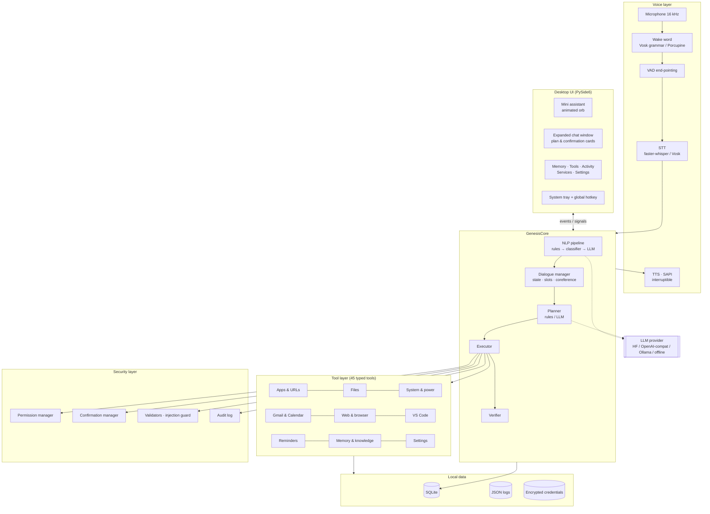

### Module map

| Layer | Package | Key classes |
|---|---|---|
| Desktop UI | `genesis/ui` | `GenesisApp`, `MiniAssistant`, `MainWindow`, `ChatPage`, `TrayController`, `OrbWidget`, `UiBridge`, `GlobalHotkey` |
| Voice | `genesis/voice` | `VoiceManager`, `Microphone`, `VoskWakeWord`/`PorcupineWakeWord`, `Endpointer`, `FasterWhisperSTT`/`VoskSTT`, `SapiTTS` |
| NLP | `genesis/nlp` | `NLUPipeline`, `rules`, `IntentClassifier`, `entities`, `DialogueManager` |
| AI | `genesis/ai` | `LLMProvider`, `HuggingFaceProvider`, `OpenAICompatibleProvider`, `OllamaProvider`, `OfflineProvider`, `ResilientLLM`, `prompts` |
| Agent | `genesis/agent` | `Planner`, `Executor`, `Plan`/`PlanStep`, `verifier.summarize` |
| Tools | `genesis/tools` | `Tool`, `ToolResult`, `ToolRegistry` + 45 tools |
| Services | `genesis/services` | `PlatformBackend` (Windows/macOS/Linux/Recording/DryRun), `AppResolver`, `GoogleAuth`, `GmailService`, `CalendarService`, `ReminderScheduler`, `BrowserController` |
| Memory | `genesis/memory` | `MemoryManager`, `KnowledgeBase`, embedding providers |
| Security | `genesis/security` | `PermissionManager`, `ConfirmationManager`, validators, injection guard, `SecretStore`, redaction |
| Data | `genesis/database` | `Database` (migrations), repositories |
| Core | `genesis/core` | `GenesisCore`, `ServiceContainer`, `GenesisConfig`, `Settings`, `EventBus`, logging |

---

## 2. NLP pipeline

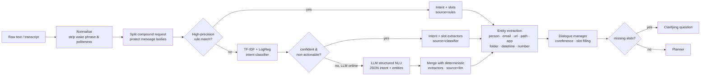

## 3. Voice pipeline

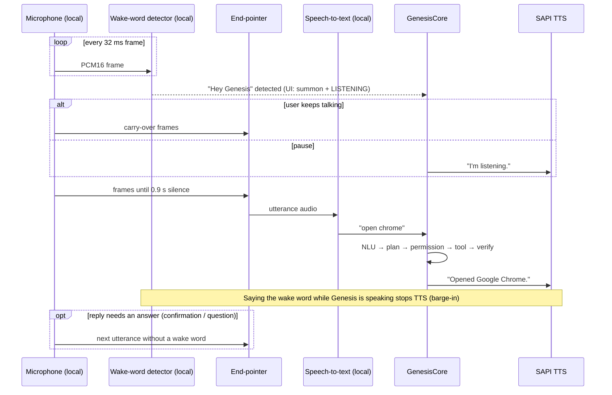

### 3a. Conversation session state machine (1.1)

A wake word, typed message, hotkey or mic click opens a **conversation session** (`genesis/core/session.py`, `SessionManager`). While it is active, voice follow-ups need no wake word. The session phase is shared by voice and text, so both follow the same timeout rules.

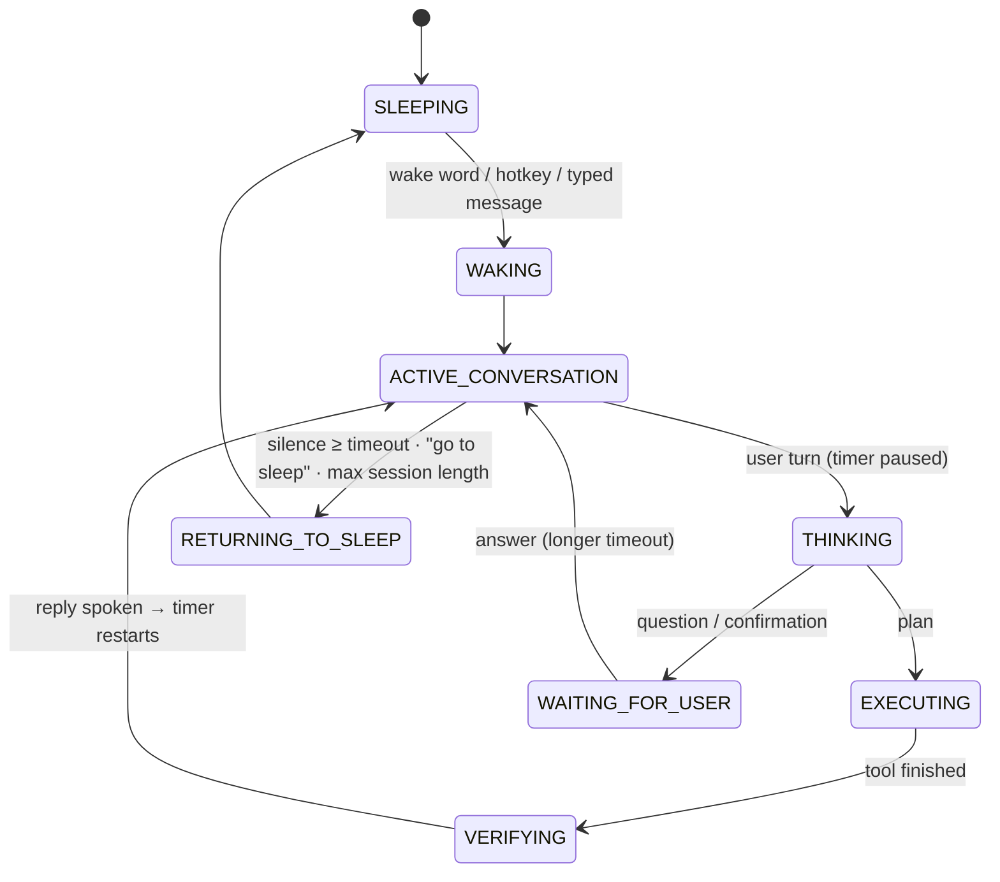

| Rule | Where |
|---|---|
| `WAITING_FOR_USER` is `AssistantState.WAITING_FOR_USER` (alias of `WAITING_FOR_INPUT`, a question), and `WAITING_FOR_CONFIRMATION` is used for yes/no confirmations | `core/events.py` |
| Inactivity countdown starts when the **reply has finished** (`response_finished`) and is paused while a turn is processed (`begin_turn`/`end_turn`) | `SessionManager` |
| `conversation.timeout_seconds` (20), `question_timeout_seconds` (45) when Genesis asked something, `max_session_minutes` (30) hard cap even with auto-sleep off | settings |
| `sleep()` refuses while a task is running, so Genesis never falls asleep mid-task | `SessionManager.sleep` |
| Voice waits for speech at most `session.remaining()` seconds, then returns to wake-word-only listening | `VoiceManager._record_and_transcribe` |
| Barge-in: wake word during TTS, or sustained speech louder than the calibrated echo level → TTS stops, the captured audio starts the next turn | `VoiceManager._speak_interruptible` |
| Every transition is logged to `logs/session.log` (no speech content) and emitted as `STATE_CHANGED` / `SESSION_CHANGED` for the UI | `logging_setup`, `ui/app.py` |

### 3b. Follow-up resolution (1.1)

`genesis/nlp/followups.py` runs **before** normal NLU for every sub-request. It uses the dialogue state's **focus stack** (the last opened app, file, folder, e-mail, draft or URL), the **last list** shown (e-mails, files, search results, issues), `last_request` / `last_failed` and the folder history. It resolves the request to a concrete tool call or intent (`FOLLOW_UP`, `REPLY_EMAIL`, `REVISE_DRAFT`, …). The result still goes through the planner → executor → permission manager, so follow-ups cannot bypass confirmations. If nothing matches unambiguously, it returns a short question.

### 3c. The agent loop (1.2)

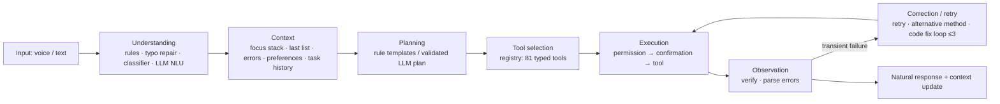

| Layer (spec) | Where it lives |
|---|---|
| Understanding | `nlp/rules.py`, `nlp/agent_rules.py` (1.2 intents), `nlp/pipeline.py` (typo repair → classifier → LLM NLU) |
| Context | `nlp/dialogue.py` (focus stack, lists, errors), `nlp/followups.py`, `memory/manager.py` (preferences), `tools/history.py` (task memory) |
| Planning | `agent/planner.py` (rules + LLM plans validated against the registry) |
| Tool selection / registry | `tools/registry.py`. Every tool declares name, description, JSON-schema parameters, risk, `run()`, `verify()`, and a confirmation prompt |
| Execution & permissions | `agent/executor.py`, `security/permissions.py`, `security/confirmation.py` |
| Observation / correction | `Tool.verify`, executor retries (`ToolResult.retryable`), alternatives inside tools (app launch), `tools/coding_agent.py` fix loop |
| Conversation manager | `core/session.py` (state machine), `voice/manager.py` |
| Memory | short-term: dialogue history; working: dialogue state and plan; long-term: facts/contacts/projects/preferences; task memory: `tasks` table + `search_history` |

Adding a capability = one `Tool` subclass in `genesis/tools/` (plus, optionally, a rule in `nlp/agent_rules.py` for fast
deterministic routing). The LLM planner discovers it from the registry automatically.

### 3d. Intelligence architecture (1.3)

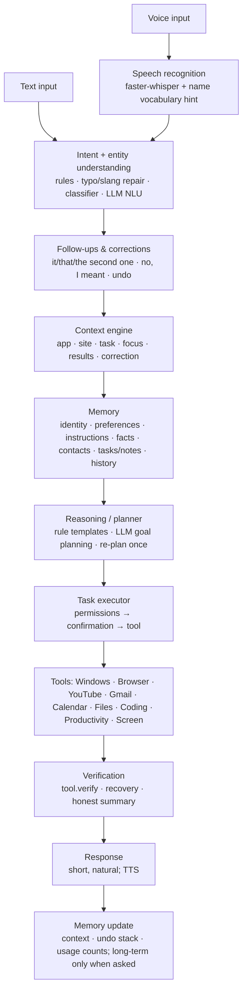

| Component | Module |
|---|---|
| Identity & name recognition | `memory/identity.py` (phonetic key + similarity; accept ≥ 0.9, confirm once ≥ 0.72; learned variants and rejections) |
| Context engine | `core/context.py` (compact snapshot used by NLU, planner and chat prompts) |
| Corrections, undo, element/ordinal follow-ups | `nlp/followups.py`, `nlp/dialogue.py` (`undo_for`) |
| Goal planning and re-planning | `agent/planner.py` (`_goal`, `plan_with_llm`), `core/assistant.py` (`_replan`, `looks_like_request`) |
| Universal browser layer | `services/browser.py` (`elements`, `click_element`, `scroll`, `press`), `tools/web.py` (`rank_elements`) |
| Project changes & commands | `tools/code_changes.py` |
| Tasks & notes | `tools/productivity.py`, migration v3 |
| Caches | `ai/llm/factory.py` (LLM), `services/youtube.py`, `services/web.py` |

## 4. Agent execution pipeline

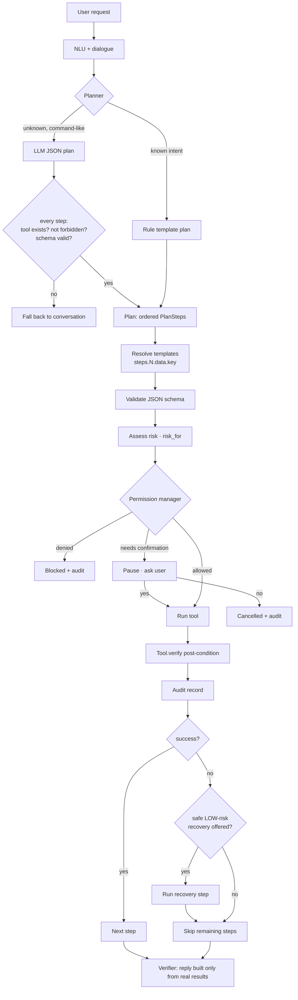

## 5. E-mail workflow

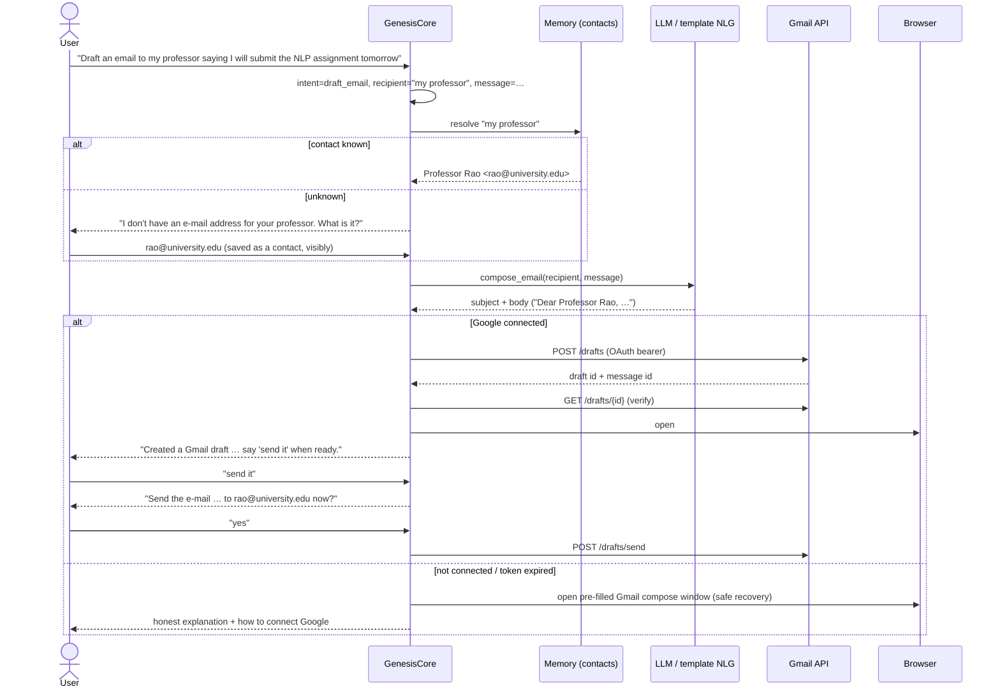

## 6. Tool execution workflow

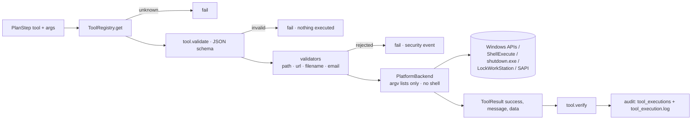

## 7. Security & permission flow

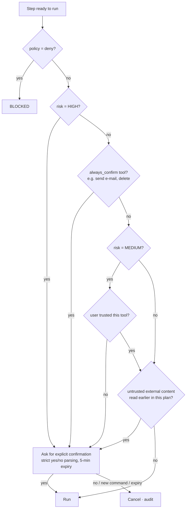

## 8. Memory architecture

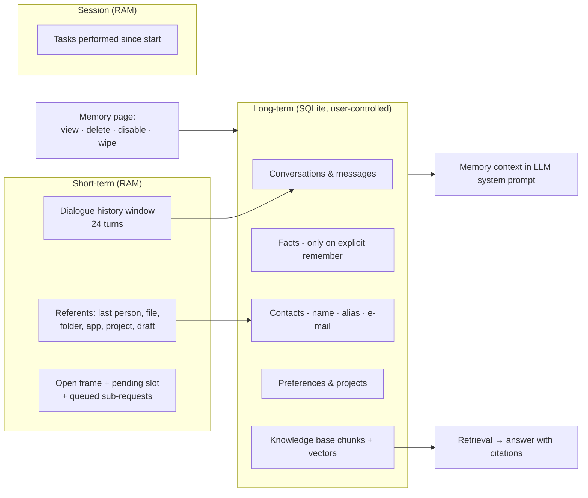

## 9. Data flow (what stays local)

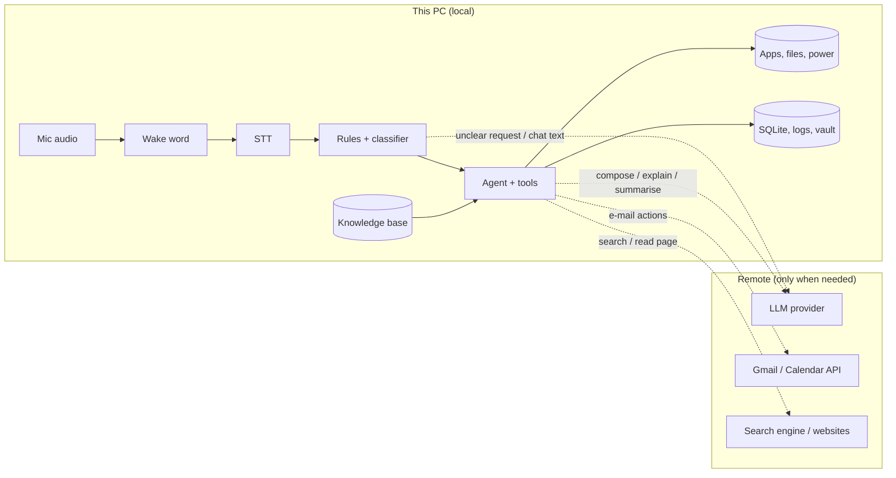

Raw audio never leaves the machine unless you explicitly select the Hugging Face STT engine. With `GENESIS_LLM_PROVIDER=ollama`, no request text leaves the machine either.

---

## Threading model

| Thread | Work |
|---|---|
| Qt GUI thread | all widgets; receives events through queued signals |
| `genesis-ui-worker` pool (2) | `core.handle()` for typed input, OAuth, indexing |
| `genesis-voice` | microphone loop, wake word, recording, STT, calls `core.handle()` |
| `genesis-tts-*` | SAPI COM object (thread-affine) |
| `genesis-reminders` | reminder scheduler (10 s tick) |
| `genesis-hotkey` | Win32 message loop for `RegisterHotKey` |
| `genesis-browser` | Playwright (thread-bound sync API) |

`GenesisCore.handle` is serialised with a re-entrant lock, so voice and text requests never interleave.

## Extending Genesis

- **New tool:** subclass `Tool` in `genesis/tools/<module>.py`. Define `name`, `description`, `parameters` (JSON schema), `risk`, `run()` and optionally `verify()`. Add it to that module's `TOOLS` list. The registry, the Tools page, the LLM planner catalogue and `docs/TOOLS.md` (run `scripts/gen_tool_docs.py`) pick it up automatically.
- **New intent:** add it to `Intent` in `nlp/intents.py`, add examples to `nlp/data/intents.json` (the classifier retrains at start-up), optionally add a rule in `nlp/rules.py`, and add a mapping in `Planner.build`.
- **New LLM provider:** subclass `LLMProvider` (or reuse `OpenAICompatibleProvider`) and register it in `ai/llm/factory.py`.
