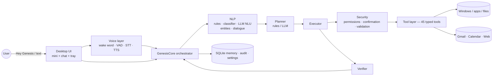

# GENESIS — Intelligent Desktop AI Assistant

> *“I have an AI assistant living on my computer that I can talk to and ask to perform tasks.”*

Genesis is a **Windows desktop AI assistant**. It lives in the system tray, wakes up when you say **“Hey Genesis”** (or press **Ctrl+Alt+G**), understands what you ask using an NLP pipeline, plans the work, checks permissions, **actually carries out the task** through a controlled tool layer, checks that it worked, and tells you the result in text and speech.

```
VOICE / TEXT → UNDERSTANDING → PLANNING → PERMISSION → REAL TOOL EXECUTION → VERIFICATION → RESPONSE (+ TTS)
```

**NLP topic (CO1):** Conversational AI / Chatbot Systems. The full academic report is in [`docs/academic/CO1_NLP_Report.md`](docs/academic/CO1_NLP_Report.md).

---

## What it does

| You say | Genesis does |
|---|---|
| “Hey Genesis, open Chrome” | launches Chrome |
| “Open Gmail” | opens Gmail in your browser |
| “Open my Downloads folder” | opens it in File Explorer |
| “Search the web for the latest NVIDIA announcement” | runs the search in your browser (and summarises the top results if the optional search package is installed) |
| “Draft an email to my professor saying I will submit the NLP assignment tomorrow” | looks up “my professor” in your contacts, writes the e-mail, **creates a real Gmail draft** through the Gmail API and opens it for review. It sends only if you say “send it” **and** confirm |
| “Draft an email to Rahul.” → “What should I say?” → “Tell him I'll reach at 5.” | multi-turn dialogue with coreference (“him” = Rahul) |
| “Remind me tomorrow at 9 AM to submit my assignment” | creates a persistent reminder that pops up and is spoken at 9:00 |
| “Open VS Code and open my Genesis project” | launches VS Code on the project folder |
| “Find the error in app/main.py” | static check (never runs your code) + LLM explanation |
| “Shut down my computer” | asks *“This will shut down your computer. Do you want me to continue?”* and only acts on an explicit **yes** |
| “Find the latest assignment PDF, rename it, open Gmail, attach it, and draft an email to my professor” | a multi-step plan with follow-up questions, a confirmation for the rename, and a draft with the attachment |

## Features

- **Two UI states.** A compact floating **mini assistant** with an animated orb (idle, listening, thinking, executing, speaking, waiting for confirmation, error, success) and an expanded **desktop chat window** with conversations, live plan/tool cards, confirmation cards, and Memory, Tools & permissions, Activity (audit log), Connected services, and Settings pages.
- **System tray.** Open, start/stop listening, pause, settings, memory, services, activity, and quit. Optional *start with Windows*. Global hotkey. Single running instance.
- **Voice.** Local wake word (“Hey Genesis”) with Vosk constrained-grammar keyword spotting or Picovoice Porcupine. Energy-based voice activity detection. Local speech-to-text with faster-whisper (Vosk as fallback). Windows SAPI text-to-speech that you can interrupt (barge-in). Visible microphone privacy indicator; the mic is physically closed when listening is off.
- **NLP pipeline.** Wake-phrase normalisation, splitting of compound requests, high-precision rules, a **TF-IDF + logistic-regression intent classifier**, an optional **LLM structured-NLU** fallback, entity extraction (people, e-mails, URLs, paths, apps, folders, dates and times), and a **dialogue manager** with slot filling and coreference.
- **LLM abstraction.** Hugging Face Inference Providers (default **Qwen/Qwen2.5-7B-Instruct**), any OpenAI-compatible endpoint, **Ollama** (fully local), or an offline ELIZA-style fallback. Degrades gracefully with no network.
- **Agent.** Rule-based and LLM planner, then an executor that resolves templates, validates the schema, checks permissions, confirms, runs the tool, verifies the result and writes an audit record, then a verifier that builds the reply only from actual tool results. Safe automatic recovery (for example, a Gmail compose window when OAuth has expired).
- **45 typed tools.** Apps, files, web, browser automation (Playwright), system/power, Gmail, Calendar, reminders, VS Code, memory, knowledge base, and settings. **There is no “run any shell command” tool.**
- **Gmail.** OAuth 2.0 loopback flow with PKCE. Tokens are kept in Windows Credential Manager or a DPAPI-encrypted vault. Create a draft, send only after confirmation, and search/read mail (treated as untrusted content).
- **Memory.** Short-term dialogue state, session tasks, persisted conversations, and explicit long-term facts, contacts and projects. You can view, delete or disable all of it.
- **Knowledge base (RAG).** Ingest txt, md, pdf, docx and code files, chunk them, embed them (all-MiniLM-L6-v2, or a local hashing fallback), retrieve by cosine similarity, and answer with citations.
- **Security.** Risk levels, a permission manager, a confirmation manager, path/URL/filename/e-mail validation, write-protection for system folders, a block on credential stores, prompt-injection defences, secret redaction in every log, and an audit trail.
- **Tests.** 164 automated tests covering unit, integration, tools, security, database, NLP, agent, voice pipeline and end-to-end scenarios.

## Quick start (Windows 10/11 + VS Code)

1. Install **Python 3.12** from [python.org](https://www.python.org/downloads/) and tick “Add python.exe to PATH”. Install **VS Code**.
2. Unzip Genesis, then in VS Code use **File → Open Folder…** and choose the `genesis` folder. Install the recommended extensions when prompted.
3. Run the first-time setup. Either double-click **`setup.bat`**, or in VS Code use **Terminal → Run Task… → “Genesis: First-time setup”**.
   This creates `.venv`, installs dependencies, creates `.env`, downloads the offline voice model (~40 MB), runs `--doctor`, and runs the tests.
4. *(Recommended)* Open `.env` and set `HF_TOKEN=` to your Hugging Face token (see [docs/SETUP.md](docs/SETUP.md#hugging-face-token)).
   Without it Genesis still works, but in offline mode: all local actions work, and open-ended chat is limited.
5. *(For Gmail drafts)* Add `GOOGLE_CLIENT_ID` and `GOOGLE_CLIENT_SECRET` ([step-by-step guide](docs/SETUP.md#gmail-google-oauth)), then go to **Genesis → Connected services → Connect Google account**.
6. Press **F5** in VS Code and pick **“Genesis: Desktop app”**. You can also double-click `run_genesis.bat`, or run:
   ```powershell
   .\.venv\Scripts\python.exe -m genesis
   ```
7. Say **“Hey Genesis”**, press **Ctrl+Alt+G**, or click the tray orb.

> **Demo tip:** choose the launch configuration **“Genesis: Desktop app (dry-run power actions)”** so that shutdown, restart, sleep and lock are simulated during presentations.

### Other ways to run

```powershell
python -m genesis --cli          # text chat in the terminal (same brain, no GUI)
python -m genesis --cli --voice  # terminal + "Hey Genesis"
python -m genesis --doctor       # check dependencies, models, keys, microphone
python -m genesis --minimized    # start silently in the tray
python -m pytest -q              # run the test suite
```

## Architecture at a glance



More detail, with nine Mermaid diagrams, is in [docs/architecture/ARCHITECTURE.md](docs/architecture/ARCHITECTURE.md).

## Project structure

```
genesis/
├── genesis/                 # application package
│   ├── core/                # config, paths, logging, events, settings, container, orchestrator, startup
│   ├── nlp/                 # rules, classifier (+data/intents.json), entities, pipeline, dialogue
│   ├── ai/                  # prompts + LLM providers (HF, OpenAI-compatible, Ollama, offline)
│   ├── agent/               # plan, planner, executor, verifier
│   ├── tools/               # 45 tools: apps, files, web, system, email, reminders, code, memory, knowledge, settings
│   ├── services/            # platform backend, app resolver, Google OAuth, Gmail, Calendar, scheduler, web, browser
│   ├── memory/              # memory manager, embeddings, knowledge base (RAG)
│   ├── security/            # permissions, confirmation, validators, injection, secrets, redaction
│   ├── voice/               # audio, VAD, wake word, STT, TTS, voice state machine
│   ├── database/            # SQLite + migrations + repositories
│   ├── ui/                  # PySide6 desktop UI (mini window, main window, pages, tray, orb, hotkey)
│   ├── cli.py · doctor.py · __main__.py
├── tests/                   # 164 tests (unittest-compatible, run with pytest)
├── docs/                    # setup, architecture, NLP, API, tools, security, troubleshooting, academic/
├── scripts/                 # setup, model download, build, icon, tool-doc generator
├── installer/genesis.iss    # Inno Setup installer script
├── .vscode/                 # launch/debug configs, tasks, settings
├── data/ · logs/            # runtime data (created automatically)
├── .env.example · requirements*.txt · pyproject.toml · LICENSE
```

## Documentation

| Topic | File |
|---|---|
| Installation & credentials (HF token, Google OAuth, Vosk, Ollama) | [docs/SETUP.md](docs/SETUP.md) |
| Architecture & diagrams | [docs/architecture/ARCHITECTURE.md](docs/architecture/ARCHITECTURE.md) |
| NLP pipeline | [docs/nlp/NLP_PIPELINE.md](docs/nlp/NLP_PIPELINE.md) |
| Core / tool / event API | [docs/api/API.md](docs/api/API.md) |
| Tool reference (generated) | [docs/TOOLS.md](docs/TOOLS.md) |
| Security & privacy | [docs/SECURITY.md](docs/SECURITY.md) |
| Development, testing, building the .exe | [docs/DEVELOPMENT.md](docs/DEVELOPMENT.md) |
| Troubleshooting | [docs/TROUBLESHOOTING.md](docs/TROUBLESHOOTING.md) |
| CO1 NLP report | [docs/academic/CO1_NLP_Report.md](docs/academic/CO1_NLP_Report.md) |
| Literature review | [docs/academic/LITERATURE_REVIEW.md](docs/academic/LITERATURE_REVIEW.md) |
| Presentation outline | [docs/academic/PRESENTATION.md](docs/academic/PRESENTATION.md) |
| Demo script | [docs/academic/DEMO_SCRIPT.md](docs/academic/DEMO_SCRIPT.md) |

## Honest limitations

- **Windows first.** macOS and Linux backends exist for OS actions, but only Windows is the supported desktop target.
- **Wake-word accuracy.** The default Vosk keyword spotter is free and fully local, but it is less robust than a custom-trained Porcupine model. Adjust the sensitivity in Settings, or use Porcupine with a custom “Hey Genesis” `.ppn` file.
- **Gmail needs a Google Cloud OAuth client** (free). Until one is configured, Genesis opens a *pre-filled Gmail compose window* instead of creating the draft through the API, and says so clearly.
- **Open-ended chat, code explanation, and LLM planning need an LLM** (a Hugging Face token, an OpenAI-compatible endpoint, or local Ollama). Everything else runs offline.
- **Browser clicking and form filling** need the optional Playwright install. Without it, Genesis says it can't do that step instead of pretending it did.

## License

MIT. See [LICENSE](LICENSE).
